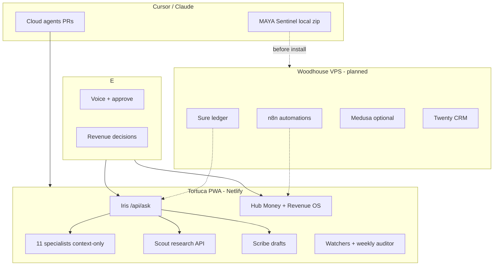

# IRIS fleet + goals optimization (whole system)

**Audience:** E + anyone operating Tortuca / IRIS across devices.  
**Last updated:** Nov 26, 2026 (America/Chicago).

This is the **single map** for what you already built, what is coming (Revenue OS Jan 1, 2027), and how **each device earns its place** so agents stay fast, cheap, and safe.

---

## 1. What you are optimizing toward

| Horizon | Goal | Iris / ops role |
|---------|------|-----------------|
| **Now → Dec 31, 2026** | Revenue OS **prep** (36 days in app) | Hub Money, launch checklist, Scout thumbnail pricing, Jan prep checkboxes |
| **Jan 1, 2027** | **Activate** hybrid income | Thumbnails + Easy Supply; bootstrap ads cap |
| **Short freedom** | **$2k/mo** (60% shop / 40% service) | Daily one-line revenue brief + Revenue panel MTD |
| **Long** | **$10k/mo** | Woodhouse + CRM + n8n when SERVER_PLAN triggers |
| **Always** | Family Purpose privacy, ECS network, school hours | Focus modes, no student names in Iris memory |
| **Parallel** | Game finish / City Nights / flight | Status in Team → Game studio (not extra specialists) |

**Kill rules (Iris must enforce in speech):** max **2** income experiments · **11–15 hr/wk** · **~$200/mo** tools/ads without explicit OK · Shopify heavy ads only after checklist green.

---

## 2. Software stack (what “agents” actually are)

| Layer | What it does | Cost control |
|-------|----------------|---------------|
| **Iris** (`/api/ask`) | Chief of staff; tools + Right now context | Daily turn cap; prompt cache on stable system |
| **Specialists** | Module experts — **Ledger…Woodhouse** | Only **Scout + Scribe** hit extra APIs; rest = context |
| **Business Researcher** | Long web research | Daily run limit |
| **Cloud agents** (Cursor) | Code, docs, cherry-pick adapters | One PR theme per branch; `npm run test:os` |
| **Weekly auditor** | Production smoke | Mon scheduled; Team card |
| **MAYA Sentinel** (local) | ZIP scan **before** installing OSS | Free; iMac loopback only |
| **VPS sidecars** | Sure, n8n, Medusa, God's Eye | ~$20–45/mo when turned on — see [`SERVER_PLAN.md`](./SERVER_PLAN.md) |

**Cherry-picks index:** [`CHERRY_PICK_OPEN_SOURCE.md`](./CHERRY_PICK_OPEN_SOURCE.md) (Sure, Medusa, Astryx, MAYA Sentinel, workshops, games).

---

## 3. Hardware fleet — assign one primary job per machine

Avoid “everything on everything.” **Tailscale** is the glue (start on phone + one Mac + Chromebooks when ready).

| Device | Primary role | IRIS / agents | Secondary |
|--------|----------------|---------------|-----------|
| **iPhone** | **Field chief of staff** — voice, push, commute | PWA portrait; tap orb → `voice.prime()`; morning brief | Stocks, inbox triage cues |
| **iPad (older)** | **Ops console** — landscape command deck | PWA ≥833px: status \| orb \| up next; Hub → Revenue OS prep checkboxes | Client thumbnail **review** (full screen); Family Purpose read-only kiosk (one account) |
| **Chromebook #1** | **Keyboard + school / network** | Landscape PWA; Plan, Research, Team, Woodhouse | Cursor in browser for agents; `npm run test:thin` only in Linux if dev container |
| **Chromebook #2** | **Thumbnail factory + Scout** | Research module presets; Hub Money logging | Browser creative tools; game smoke / [`test:devices`](./CROSS_DEVICE_AUDIT.md) QA |
| **Mac mini** | **Always-on home node** (if on 24/7) | Host **God's Eye** or Tailscale subnet router; **not** Iris server (Netlify is) | `npm run dev` + `netlify dev` for local API debug; backup target |
| **iMac** | **Heavy station** | Open Jarvis / desktop briefings; **MAYA Sentinel** scans; clone repos to `/tmp` | Cursor Desktop + MCP; [`gods-eye/bootstrap.sh`](../gods-eye/bootstrap.sh); audio2face sidecar (future) |

### Device-specific Iris UX (already in code — use them)

| Preference | Where | Effect |
|------------|--------|--------|
| **Combo HUD 1+3+5** | Settings → HUD | Phone reactor + iPad command deck + particle core |
| **Orb style** (e.g. cinema-eye) | HUD prefs | Voice + visual identity |
| **Focus mode** | School / network / weekend | Theme + Iris Right now tone |
| **PWA reload** | Background return | `appUpdate.ts` picks up deploys without force-quit |

### What not to do on old iPads

- Do not run Docker, Medusa, or Sure on iPad — VPS or Mac only.
- Do not install unknown MCP bundles without **MAYA Sentinel** on the Mac first.
- Portrait iPad = phone layout by design (thumb reach) — use **landscape** for deck.

---

## 4. Optimize Iris behavior (highest ROI, no new infra)

These align with [`IRIS_IMPROVEMENTS_RESEARCH.md`](./IRIS_IMPROVEMENTS_RESEARCH.md) and current guardrails.

### A. Context diet (every device)

1. **Morning:** spoken brief already includes **one** revenue line — don’t ask Iris to “summarize everything” unless needed.
2. **Module-first:** “Open plan” / voice fast path — no model hop ([`voiceIntents.ts`](../shared/voiceIntents.ts)).
3. **Delegates:** One specialist per question; Woodhouse blocks duplicates (`irisTeamActivity`).
4. **Revenue questions:** Hub Money MTD beats vague advice; Iris has `revenueContextForIris` + Shopify readiness.

### B. Specialist discipline

| You want… | Say / open… | Specialist |
|-----------|-------------|------------|
| Thumbnail pricing, markets | Research preset or “Scout, …” | **Scout** (API) |
| Draft email / channel post | Channels | **Scribe** (API) |
| Today / leave-by | Today | Ledger (context) |
| Money / revenue / Jan prep | Hub → Money | Curator + Revenue panel |
| Watch a URL / uptime | Hub → Watch | Curator |
| Commute / pulse | Vitals | Sentinel |
| Who already did this task | Team | **Woodhouse** |

### C. Cost + latency

- Watch **Team → Iris usage** cache hit % after changes.
- Keep research queries **long enough** (Scout min length) — one good run beats three tiny asks.
- **2 Chromebooks:** only one runs **live** Cursor agent sessions at a time to avoid duplicate PR branches.

### D. Security + cherry-pick hygiene

1. **Tortuca changes:** `npm run scan:secrets` + `test:os`.
2. **New GitHub repo:** zip → **MAYA Sentinel** on iMac (`tools/maya-sentinel/`).
3. **VPS apps:** Sure AGPL separate; read-only keys to Netlify only.

---

## 5. 90-day operating rhythm (Revenue OS + fleet)

| When | iPhone | iPad landscape | Chromebook | Mac |
|------|--------|----------------|------------|-----|
| **Daily AM** | Listen to brief; 1 voice task | Jan prep checkboxes if at desk | — | Sentinel only if new repo |
| **Mon** | — | Team → Weekly auditor | — | Review CI if email fires |
| **Wed** | Log thumbnail $ in Hub | Revenue OS bars | Scout: pricing/competitors | — |
| **Weekly** | Shopify checklist 1 item | Same | Easy Supply admin (Shopify web) | Clone/zap VPS only if blocked |
| **Eve** | Wind-down | — | — | — |

**Jan 1 prep:** in-app list from [`REVENUE_OS_JAN2027_ACTIVATION.md`](./REVENUE_OS_JAN2027_ACTIVATION.md) — single source `shared/revenueActivationPlan.ts`.

---

## 6. Infrastructure sequencing (do not front-load)

| Phase | Trigger | Action |
|-------|---------|--------|
| **0** | Now | Tailscale on phone + Mac mini **or** iMac + one Chromebook |
| **1** | Weekly Gmail→sheet pain | VPS + n8n ([`SERVER_PLAN.md`](./SERVER_PLAN.md) step 3) |
| **1b** | Cash tracking beyond Hub | Sure on VPS; `SURE_*` in Netlify |
| **2** | Sponsor / $BAY pipeline | Twenty CRM |
| **Commerce** | Shopify checklist **done** | Stay Shopify; revisit Medusa only if fees hurt |
| **Voice quality** | PWA TTS limits | Pipecat/Kokoro on VPS (later) |

---

## 7. Agent effectiveness checklist (you + cloud agents)

**You**

- [ ] One **active income** focus (thumbnails first).
- [ ] Each device has **one primary job** (section 3).
- [ ] iPad landscape = Revenue + Hub; phone = voice + commute.
- [ ] Cherry-pick script: Sentinel → doc → thin adapter → PR.

**Cloud agents (Cursor)**

- [ ] Read `AGENTS.md` + active deep-dive doc.
- [ ] Minimal diff; `npm run test:os`.
- [ ] No weakening session gates / `safeFact`.
- [ ] Revenue work references `REVENUE_OS.md`.

**Iris (product)**

- [ ] Tier 1 from improvements doc before Tier 4 streaming bets.
- [ ] Woodhouse nodes filled as URLs exist (Easy Supply, Family Purpose, Sure).

---

## 8. Gaps worth a deliberate decision (not auto-built)

1. **Mac mini vs iMac as 24/7** — pick **one** for God's Eye / Tailscale always-on (lower power wins).
2. **Chromebook Linux dev** — optional; browser + PWA is enough for ops until you need local `netlify dev`.
3. **Second iPad** — dedicated Family Purpose vs duplicate Revenue deck (avoid two writers on same Hub account offline).
4. **Streaming ask / LiveKit** — Tier 4; only if voice latency blocks daily use on iPhone.

---

## Related docs

| Doc | Topic |
|-----|--------|
| [`REVENUE_OS.md`](./REVENUE_OS.md) | Targets, checklist, Iris rules |
| [`CROSS_DEVICE_AUDIT.md`](./CROSS_DEVICE_AUDIT.md) | PWA layout bands |
| [`IRIS_MAX_CAPACITY_AUDIT.md`](./IRIS_MAX_CAPACITY_AUDIT.md) | Ship gate + manual QA |
| [`SERVER_PLAN.md`](./SERVER_PLAN.md) | VPS apps |
| [`DEEP_DIVE_SURE_ASTRYX.md`](./DEEP_DIVE_SURE_ASTRYX.md) | Finance + UI cherry-picks |
| [`DEEP_DIVE_MEDUSA.md`](./DEEP_DIVE_MEDUSA.md) | Commerce alternate |
| [`DEEP_DIVE_MAYA_SENTINEL.md`](./DEEP_DIVE_MAYA_SENTINEL.md) | Pre-install scans |